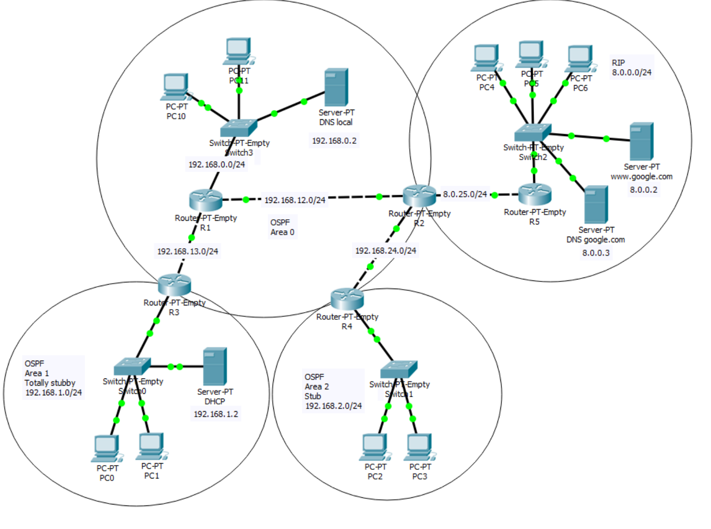

# Multi-Area Network Simulation (OSPF + RIPv2)

A Cisco Packet Tracer lab that models an enterprise-style network split into an **OSPF domain** (three areas of different types) and a **RIPv2 domain**, joined by an autonomous system boundary router. The lab combines static IP planning with DHCP, route redistribution, remote access over Telnet, DNS resolution across segments, and ACL-based traffic filtering.

## Table of Contents

- [Topology](#topology)
- [Addressing Plan](#addressing-plan)
- [Features](#features)
  - [1. Base Configuration](#1-base-configuration)
  - [2. DHCP](#2-dhcp)
  - [3. RIPv2](#3-ripv2)
  - [4. OSPF](#4-ospf)
  - [5. Route Redistribution](#5-route-redistribution)
  - [6. Telnet Remote Access](#6-telnet-remote-access)
  - [7. DNS](#7-dns)
  - [8. Access Control Lists](#8-access-control-lists)
- [Getting Started](#getting-started)
- [Verification](#verification)
- [Technologies](#technologies)
- [License](#license)

## Topology

The network consists of five routers, four switches, nine end hosts and four servers.



| Router | Role |
|--------|------|
| R1 | OSPF backbone router, hosts the local LAN (Area 0) and the Telnet-enabled device |
| R2 | ASBR: border between the OSPF and RIP domains, performs route redistribution |
| R3 | ABR between Area 0 and Area 1 (totally stubby) |
| R4 | ABR between Area 0 and Area 2 (stub) |
| R5 | RIP segment router: DHCP server for the RIP LAN and ACL enforcement point |

## Addressing Plan

Addressing follows a consistent set of rules:

- Router interfaces use the **lowest available address** of their network.
- Point-to-point links between routers use the **two lowest addresses**; the router with the lower index gets the lower address.
- Servers use fixed, predefined addresses with the nearest router as default gateway.
- Hosts without DHCP use the lowest free addresses of their network, with the nearest router as gateway and `192.168.0.2` as DNS server.

| Network | Purpose | Router address(es) |
|---------|---------|--------------------|
| 192.168.0.0/24 | Area 0 LAN (Switch3) | R1: 192.168.0.1 |
| 192.168.12.0/24 | R1 ↔ R2 link (Area 0) | R1: .1, R2: .2 |
| 192.168.13.0/24 | R1 ↔ R3 link (Area 0) | R1: .1, R3: .2 |
| 192.168.24.0/24 | R2 ↔ R4 link (Area 0) | R2: .1, R4: .2 |
| 192.168.1.0/24 | Area 1 LAN (Switch0) | R3: 192.168.1.1 |
| 192.168.2.0/24 | Area 2 LAN (Switch1) | R4: 192.168.2.1 |
| 8.0.25.0/24 | R2 ↔ R5 link (OSPF/RIP boundary) | R2: .1, R5: .2 |
| 8.0.0.0/24 | RIP LAN (Switch2) | R5: 8.0.0.1 |

| Server | Address | Location |
|--------|---------|----------|
| Local DNS | 192.168.0.2 | Area 0 |
| DHCP | 192.168.1.2 | Area 1 |
| www.google.com (web) | 8.0.0.2 | RIP segment |
| google.com DNS | 8.0.0.3 | RIP segment |

## Features

### 1. Base Configuration

All devices are interconnected as shown in the topology and configured with IP parameters according to the [addressing rules](#addressing-plan).

### 2. DHCP

**Area 1 (DHCP server at 192.168.1.2)** serves PC0 and PC1:

- Address pool starts at `192.168.1.23`
- Subnet mask `255.255.255.0` (derived from the existing addressing)
- Default gateway: R3
- DNS server: `192.168.0.2` (located in Area 0)

**RIP segment (DHCP on router R5)** serves PC4, PC5 and PC6:

- Pool from `8.0.0.0/24`, mask `255.255.255.0`
- Excluded ranges: `8.0.0.0/28` and `8.0.0.18 – 8.0.0.24`
- Default gateway: R5
- DNS server: `8.0.0.3`

### 3. RIPv2

RIP version 2 is enabled on routers **R2** and **R5** to provide routing inside the RIP segment and towards the OSPF boundary.

### 4. OSPF

OSPF runs on **R1, R2, R3 and R4** and provides full IP connectivity across the OSPF segment, taking the different area types into account:

| Area | Type | Border router | Notes |
|------|------|---------------|-------|
| Area 0 | Backbone | R1, R2, R3, R4 | Transit area for all inter-area traffic |
| Area 1 | Totally stubby | R3 | Receives only a default route from the ABR (no external or inter-area routes) |
| Area 2 | Stub | R4 | No external routes; inter-area routes are still advertised |

### 5. Route Redistribution

Redistribution is performed on the boundary router **R2**:

- **RIP → OSPF:** seed metric `25`, configured so the metric stays unchanged throughout the OSPF domain (external type 2)
- **OSPF → RIP:** seed metric `1`

This gives hosts in both domains end-to-end reachability.

### 6. Telnet Remote Access

Remote management of **R1** is enabled over Telnet and protected by a password on the VTY lines. The setup is verified by attaching a laptop to the router via a console cable.

### 7. DNS

- The **local DNS server** (Area 0) forwards all `.com` lookups to the server at `8.0.0.3`.
- The **google.com DNS server** (RIP segment) resolves `google.com` and `www.google.com`.
- Verification: opening `google.com` in a browser from any host in the OSPF segment.

### 8. Access Control Lists

Extended ACLs on **R5** restrict traffic towards the RIP segment:

- The DNS server (`8.0.0.3`) is reachable **only with DNS requests**.
- The web server (`google.com`) is reachable **only via HTTP or ICMP Echo Request**.
- ICMP Echo Request is permitted towards **all devices in the RIP segment except the DNS server**.

## Getting Started

### Prerequisites

- [Cisco Packet Tracer](https://www.netacad.com/courses/packet-tracer) (a free Cisco Networking Academy account is required to download it)

### Run the Lab

1. Clone the repository:
   ```bash
   git clone https://github.com/Dz0n1V/multi-area-network-simulation.git
   ```
2. Open `multi-area-ospf-rip-network.pkt` in Cisco Packet Tracer.
3. Wait for the links to turn green and the routing protocols to converge.

## Verification

Suggested checks once the lab has converged:

| Check | Expected result |
|-------|-----------------|
| `show ip route` on R1–R4 | OSPF routes present; R2 shows redistributed RIP routes as external |
| `show ip route` on R3 | Only a default route for non-local destinations (totally stubby) |
| `show ip route` on R4 | Default route plus inter-area routes, no external routes (stub) |
| PC0, PC1, PC4–PC6 `ipconfig` | Addresses assigned via DHCP, outside the excluded ranges |
| Ping between hosts in different areas | Successful |
| Browser: `google.com` from an OSPF host | Web page loads |
| Ping `8.0.0.3` from outside | Blocked by ACL |
| Ping `8.0.0.2` / RIP hosts from outside | Successful (ICMP Echo Request allowed) |
| Telnet to R1 | Password prompt, then access granted |

## Technologies

- Cisco Packet Tracer
- Cisco IOS
- OSPF, RIPv2, DHCP, DNS, Telnet, Extended ACLs

## License

This project is licensed under the [MIT License](LICENSE).
